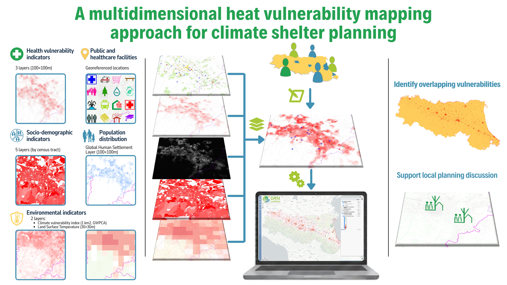

---

  

<h1 align="center">
<a href="https://oasiclimatiche.github.io/Oasi-Climatiche-ER/">A multidimensional heat vulnerability mapping approach for climate shelter planning</a>
</h1>
 

Working title: _**A multidimensional heat vulnerability mapping approach for climate shelter planning**_

  

  
This is the output for the Oasi Climatiche project's demo webGIS application:

[Link to the demo page](https://oasiclimatiche.github.io/Oasi-Climatiche-ER)

  

For feedback, additional details or observations please contact us at [our mail addresses](mailto:Serena.Broccoli@regione.emilia-romagna.it?cc=simone.agostini6@studio.unibo.it&subject=[Oasi%20Climatiche]%20Request).
   

